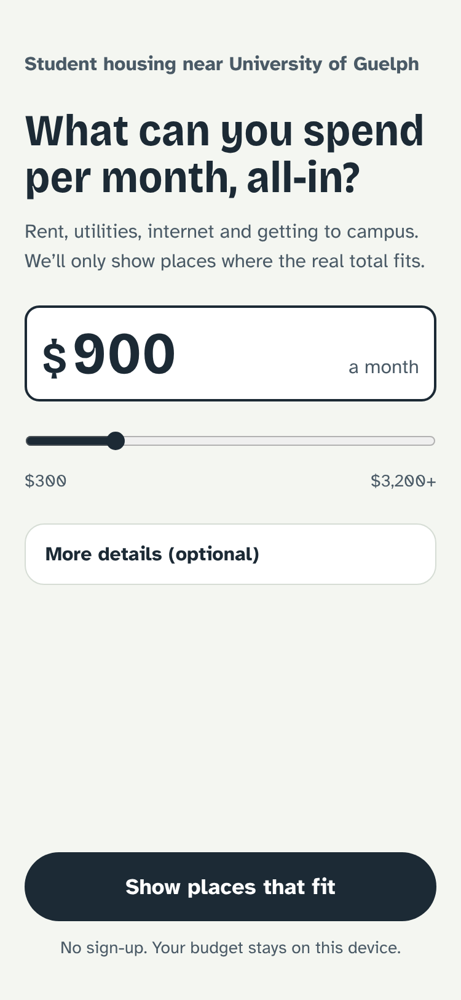
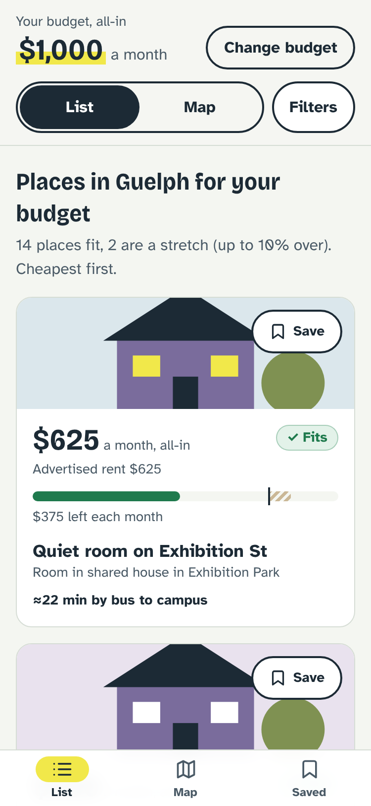
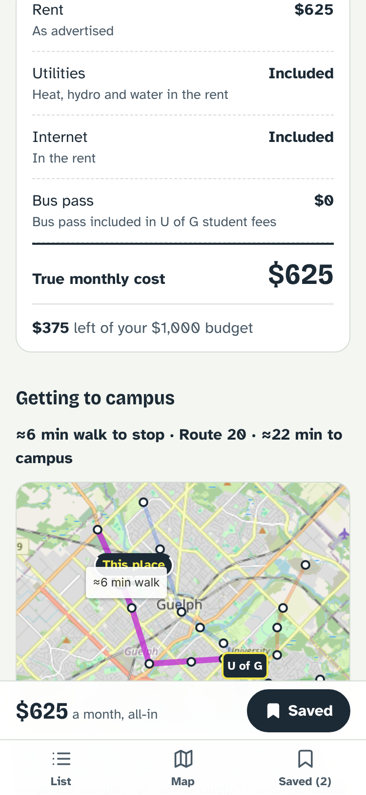
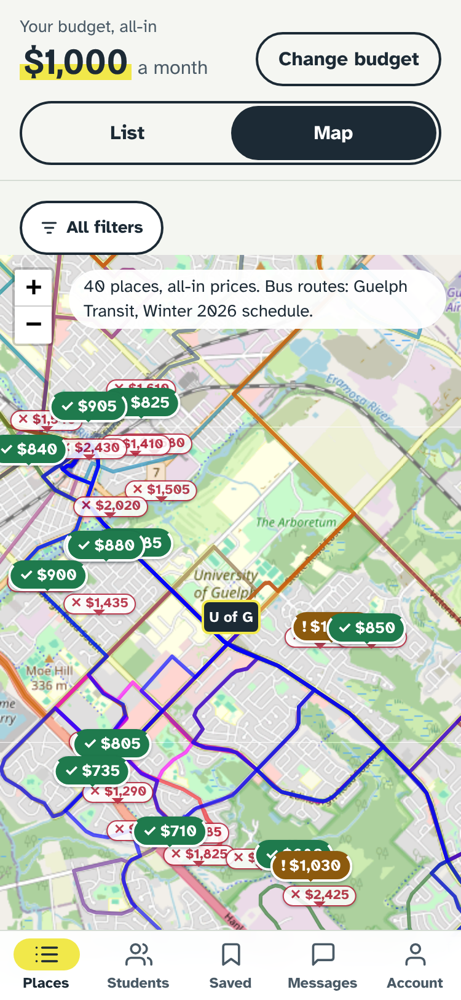
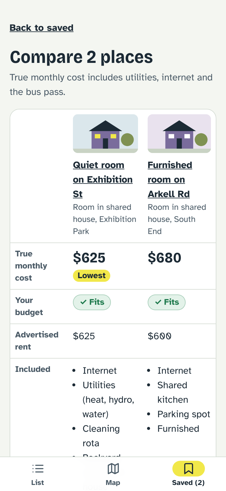
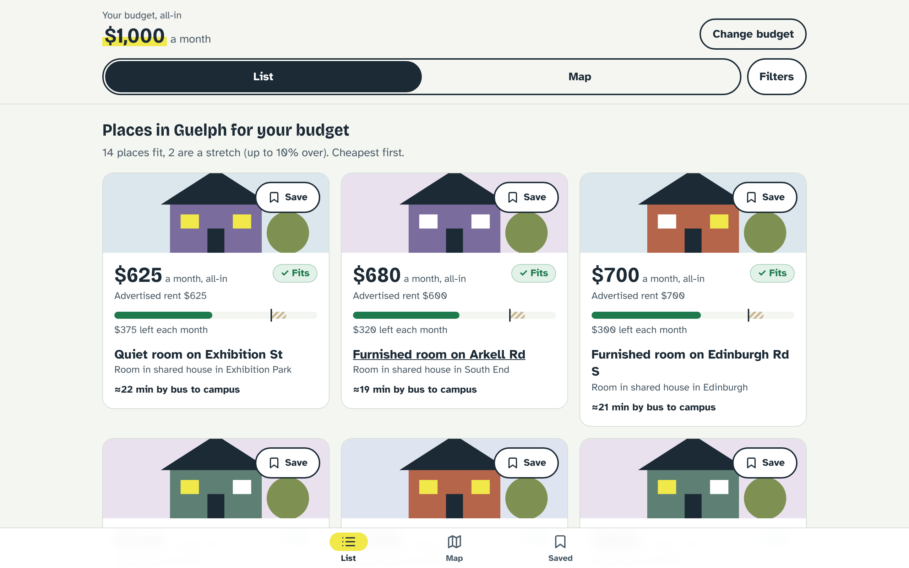

# Student Housing Portal

A budget-first housing search for University of Guelph students. You say what you can spend each month, all-in, and it shows only places that fit. Each price is the **true monthly cost** (rent plus utilities, internet and getting to campus), not just the advertised rent.

Version 1 is a portfolio piece and an idea test. It runs entirely in the browser, with no backend and no sign-up.

**Live demo:** https://bananagunz06.github.io/student-housing-portal/

| Budget | Results | Listing | Map | Compare |
|---|---|---|---|---|
|  |  |  |  |  |



## What it does

- **Budget first.** One question to start ("What can you spend per month, all-in?"), with optional move-in month and bedrooms. Your budget stays on your device.
- **True monthly cost.** Rent + utilities + internet + bus pass. Every result shows **Fits**, **Stretch** (up to 10% over) or **Over budget**, always as text and an icon, never colour alone. A meter shows the cost against your budget.
- **Results.** Fits and Stretch places, cheapest first. A list/map toggle, plus filters for bedrooms, type of place, furnished, longest commute and move-in month. When nothing fits, it suggests the nearest budget that has results ("Nothing fits $600. 3 places fit at $650.").
- **Map.** A price on every pin, coloured and marked by fit. Bus routes as lines, stops as dots, campus marked. Tap a pin for a preview.
- **Listing detail.** The cost breakdown, how much of your budget is left, what's included, and lease details. A mini-map shows the nearest stop with a dashed walking line: "≈6 min walk to stop · Route 20 · ≈22 min to campus".
- **Saved + Compare.** Save places, then compare 2 or 3 side by side.

## Run it

```bash
npm install
npm run dev      # http://localhost:5173
npm test         # unit + component tests (Vitest)
npm run lint     # oxlint
npm run build    # type-check and production build
```

## Deploy

`.github/workflows/deploy.yml` lints, tests and builds every pull request. On each push to `main` it also publishes the site to GitHub Pages. It builds with `BASE_PATH=/student-housing-portal/` so the app works under the repo's sub-path, and it copies `index.html` to `404.html` so refreshing a page like `/listing/gue-001` still loads the app.

One-time setup: in the repo's **Settings → Pages**, set **Source** to **GitHub Actions**.

## About the data (read this)

Everything here is **sample data for a demo**:

- **Listings** are 40 fictional places, priced to look like the Guelph student market. `scripts/generate-listings.mjs` generates them from a fixed seed into `src/data/listings.json`.
- **Bus routes and stops are hand-made and approximate.** The plan was to convert Guelph Transit's public GTFS feed, but the city's data hosts weren't reachable from the build environment. So `scripts/build-sample-transit.mjs` draws 4 sample routes and 26 stops through the campus loop instead. They are **not** the real Guelph Transit network or schedule. To use the real network, convert the GTFS `stops.txt` and `shapes.txt` into the same two GeoJSON files in `src/data/transit/`.
- **Photos are generated illustrations**, not real photos (`src/components/ListingArt.tsx`).
- **Bus pass is $0 a month.** U of G undergraduates pay the Universal Bus Pass (UPass) through their student fees. Change `transitMonthly` in `src/data/campus.ts` for other campuses.
- **Commute times are estimates**, marked "≈":
  - Walking: straight-line distance × 1.3 at about 80 m a minute.
  - Bus: distance along the route at about 20 km/h, plus the walk to the stop. Waiting time isn't included.
  - If the walk to campus is 15 minutes or less (or no slower than the bus), walking is shown.
- **Utilities and internet.** When they're not included, the listing's own estimate is used, falling back to the campus defaults.

Map tiles come from OpenStreetMap (free, no API key). If tiles fail to load, the map still shows pins and routes with a notice, and the list works as normal.

## How it's built

React 19 + TypeScript + Vite, React Router, Tailwind CSS 4, Leaflet with react-leaflet, and Vitest with React Testing Library. The fonts (Bricolage Grotesque and Atkinson Hyperlegible) are self-hosted from npm.

```
src/
  data/          listings.json, campus.ts, transit/ (sample GeoJSON), types.ts
  lib/
    listingsRepo.ts   the ONLY way screens get listings (getAll, getById); swap in an API here later
    cost.ts           trueMonthlyCost, fitStatus (Fits / Stretch / Over), money formatting
    commute.ts        distance, walk minutes, nearest stop, campus commute estimate
    filters.ts        evaluate listings for a budget, filter + sort, nearest budget with results
    storage.ts        localStorage hook that keeps working when storage is blocked
  state/AppState.tsx  budget, filters and saved places, remembered in the browser
  components/    BudgetInput, ListingCard, FitBadge, BudgetMeter, CostBreakdown, FilterSheet,
                 MapView, pricePin, TransitLayer, MiniMap, CompareTable, BottomNav, ListingArt
  pages/         Welcome, Results, ListingDetail, Saved, Compare, NotFound
```

The maths in `src/lib` is plain TypeScript with no React, unit-tested directly, and shared by the list, map, detail and compare screens. The map code loads only when you open a map, so the list stays light.

## Not in version 1

Accounts, landlord posting, messaging, roommate matching, rent splitting, scam warnings and real listings. The design spec is in `docs/superpowers/specs/` and the build plan is in `docs/superpowers/plans/`.
