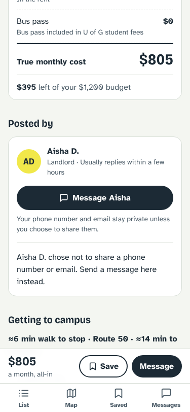
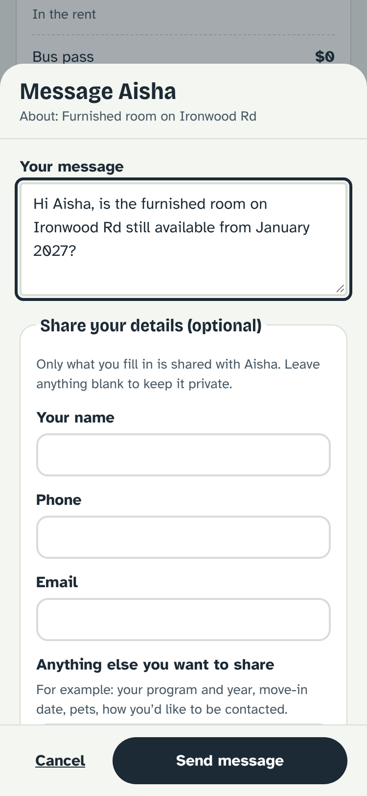
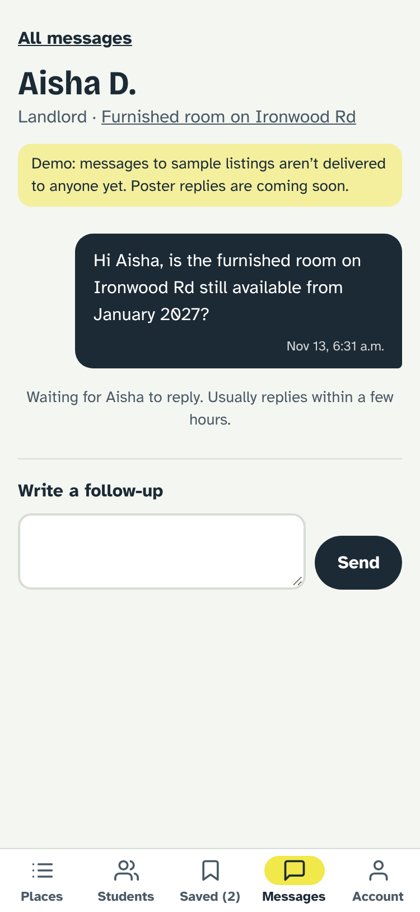

# Student Housing Portal

A budget-first housing search for University of Guelph students. You say what you can spend each month, all-in, and it shows only places that fit. Each price is the **true monthly cost** (rent plus utilities, internet and getting to campus), not just the advertised rent.

Version 1 is a portfolio piece and an idea test. Browsing needs no account. Signing in is optional and keeps your details on any device (see Accounts below).

**Live demo:** https://bananagunz06.github.io/student-housing-portal/

| Budget | Results | Listing | Map | Compare |
|---|---|---|---|---|
|  |  |  |  |  |

| Posted by | Message the poster | Conversation |
|---|---|---|
|  |  |  |


## What it does

- **Budget first.** One question to start ("What can you spend per month, all-in?"), with optional move-in month and bedrooms. Your budget stays on your device unless you sign in.
- **True monthly cost.** Rent + utilities + internet + bus pass. Every result shows **Fits**, **Stretch** (up to 10% over) or **Over budget**, always as text and an icon, never colour alone. A meter shows the cost against your budget.
- **Results.** Fits and Stretch places, cheapest first. A list/map toggle, plus filters for bedrooms, type of place, furnished, longest commute and move-in month. When nothing fits, it suggests the nearest budget that has results ("Nothing fits $600. 3 places fit at $650.").
- **Map.** A price on every pin, coloured and marked by fit. Bus routes as lines, stops as dots, campus marked. Tap a pin for a preview.
- **Listing detail.** The cost breakdown, how much of your budget is left, what's included, and lease details. A mini-map shows the nearest stop with a dashed walking line: "≈6 min walk to stop · Route 20 · ≈22 min to campus".
- **Saved + Compare.** Save places, then compare 2 or 3 side by side.
- **Contact the poster in the app.** Every listing shows who posted it (landlord, property manager or a student subletting) and how fast they usually reply. Anyone can be messaged in the app, so posters don't have to put a phone number or email online. Call, text and email links appear only for posters who chose to share them.
- **Students share only what they want.** The message form starts with an editable note ("Hi Sam, is the room on Dean Ave still available…") and optional name, phone, email and "anything else". Only filled-in details go with the message, and each sent message shows exactly what was shared. The Messages tab keeps every conversation, with follow-ups.
- **Community.** Students can set up a profile with an optional photo, short bio, program, year, move-in term and monthly budget. The **Students** tab lists only students who have switched on "Looking for roommates", and it can be filtered by move-in term and budget. Tap a card to open that student's profile. Only signed-in students can see profiles. Email and phone number are never shown on a profile.

## Run it

```bash
npm install
npm run dev      # http://localhost:5173
npm test         # unit + component tests (Vitest)
npm run lint     # oxlint
npm run build    # type-check and production build
```

## Accounts

Browsing needs no account: search, filters and every listing work without signing in. Saving places, messaging a poster and viewing student profiles ask you to sign in. Budget and filters you set before signing in move into your account when you sign in. After that, your saved places and messages are kept in the account and follow you to any device.

- **What syncs.** Once you create an account or sign in, your budget, filters, saved places and messages sync to it, so they show up on any device. Your name is kept on your profile. Your optional phone number is kept in a separate table that only you can read. The profile details you choose to fill in (photo, bio, program, year, move-in term and budget) are visible to other signed-in students only while "Looking for roommates" is on. The **Account** tab shows your email, lets you edit your details, log out, or delete your account (which removes your saved places, messages and sign-in).
- **Browsing never needs sign-in.** Only saving places and messaging a poster ask you to sign in, and you can dismiss that prompt.
- **Setup (Supabase).** The app uses [Supabase](https://supabase.com) for sign-in and storage. To run it against your own project:
  1. Create a Supabase project.
  2. Open the SQL Editor and run `supabase/migrations/0001_accounts.sql`. It creates the tables and the row-level security rules that keep each account's data private.
  3. In the SQL Editor, run `supabase/migrations/0002_profiles.sql`. It adds the profile fields, the private phone table and the private photo storage.
  4. For the demo, turn off **Confirm email** under Authentication → Sign In / Providers → Email. Otherwise new accounts must confirm by email before they can sign in.
  5. Set `VITE_SUPABASE_URL` and `VITE_SUPABASE_PUBLISHABLE_KEY` for the app. Only the publishable (anon) key belongs in the repo or the browser. Never add the secret or service_role key.
- **Data note.** Account data is demo data, like the rest of the sample app. Listings and posters are still fictional.

## Deploy

`.github/workflows/deploy.yml` lints, tests and builds every pull request. On each push to `main` it also publishes the site to GitHub Pages. It builds with `BASE_PATH=/student-housing-portal/` so the app works under the repo's sub-path, and it copies `index.html` to `404.html` so refreshing a page like `/listing/gue-001` still loads the app.

One-time setup: in the repo's **Settings → Pages**, set **Source** to **GitHub Actions**.

## About the data (read this)

Listings and posters are **sample data for a demo**, and the bus network is real:

- **Listings** are 40 fictional places, priced to look like the Guelph student market. `scripts/generate-listings.mjs` generates them from a fixed seed into `src/data/listings.json`.
- **Bus routes, stops and ride times** come from Guelph Transit's official [GTFS feed](https://mobilitydatabase.org/feeds/gtfs/mdb-3140), currently the **Winter 2026** schedule. Transit data: City of Guelph (open data licence).
- **Refreshing the bus data.** Run `node scripts/build-transit-from-gtfs.mjs` to download the latest feed, or pass the path to a downloaded zip: `node scripts/build-transit-from-gtfs.mjs path/to/feed.zip`. It rewrites `routes.geojson`, `stops.geojson` and `meta.json` in `src/data/transit/`. The parsing helpers live in `scripts/lib/gtfs.mjs`.
- **Posters are fictional.** Names are made up, phone numbers use the reserved 555-01xx range and emails use `example.com`. About a third of posters share no phone or email, so messaging in the app is their only contact.
- **Messaging is a demo.** Messages to sample listings aren't delivered to anyone, and posters can't reply yet. Messages are kept in your account, so they follow you to any device. The app says so on the message form and the Messages tab. Making it real needs a server that stores and delivers messages and gives posters an inbox; `AppState.sendMessage` and `listingsRepo` are where that would plug in.
- **Photos are generated illustrations**, not real photos (`src/components/ListingArt.tsx`).
- **Bus pass is $0 a month.** U of G undergraduates pay the Universal Bus Pass (UPass) through their student fees. Change `transitMonthly` in `src/data/campus.ts` for other campuses.
- **Commute times are estimates**, marked "≈":
  - If the walk to campus is 15 minutes or less (or no slower than the bus), walking is shown.
  - Otherwise, the best of a direct bus or one change of bus, from a stop within a 15-minute walk. Ride times are the median scheduled minutes on a typical weekday morning; a change of buses adds 5 minutes. Waiting for the bus isn't included.
  - Walking: straight-line distance × 1.3 at about 80 m a minute.
  - If no bus is within reach, the walking time is shown with "(no bus nearby)".
- **Utilities and internet.** When they're not included, the listing's own estimate is used, falling back to the campus defaults.

Map tiles come from OpenStreetMap (free, no API key). If tiles fail to load, the map still shows pins and routes with a notice, and the list works as normal.

## How it's built

React 19 + TypeScript + Vite, React Router, Tailwind CSS 4, Leaflet with react-leaflet, and Vitest with React Testing Library. The fonts (Bricolage Grotesque and Atkinson Hyperlegible) are self-hosted from npm.

```
src/
  data/          listings.json, campus.ts, types.ts, transit/ (routes.geojson, stops.geojson, meta.json generated from GTFS)
  lib/
    listingsRepo.ts   the ONLY way screens get listings (getAll, getById); swap in an API here later
    cost.ts           trueMonthlyCost, fitStatus (Fits / Stretch / Over), money formatting
    commute.ts        distance, walk minutes, nearest stop, campus commute estimate
    filters.ts        evaluate listings for a budget, filter + sort, nearest budget with results
    messages.ts       message validation, what gets shared, starter text, conversations
    useModal.ts       shared bottom-sheet behaviour (focus trap, Escape, scroll lock)
    storage.ts        localStorage hook that keeps working when storage is blocked
    profile.ts        profile rules: years, terms, budget bands, validation
    avatar.ts         photo checks and resizing
    backend/          Supabase sign-in, profiles and storage (bands.ts: budget band ranges)
  state/AppState.tsx  budget, filters, saved places and sent messages, remembered in the browser
  components/    BudgetInput, ListingCard, FitBadge, BudgetMeter, CostBreakdown, FilterSheet,
                 MapView, pricePin, TransitLayer, MiniMap, CompareTable, BottomNav, ListingArt,
                 PosterCard, MessageSheet, Avatar, ProfileForm, StudentCard
  pages/         Welcome, Results, ListingDetail, Saved, Compare, Messages, Conversation, Account,
                 ProfileSetup, Students, StudentProfile, NotFound
scripts/
  build-transit-from-gtfs.mjs   converts Guelph Transit's GTFS feed into src/data/transit/
  lib/gtfs.mjs                  pure GTFS helpers (unit-tested)
  generate-listings.mjs         generates the sample listings
```

The maths in `src/lib` is plain TypeScript with no React, unit-tested directly, and shared by the list, map, detail and compare screens. The map code loads only when you open a map, so the list stays light.

## Not in version 1

Landlord posting, real message delivery and poster replies, direct messages between students (part 2), rent splitting, scam warnings and real listings. The design spec is in `docs/superpowers/specs/` and the build plan is in `docs/superpowers/plans/`.
